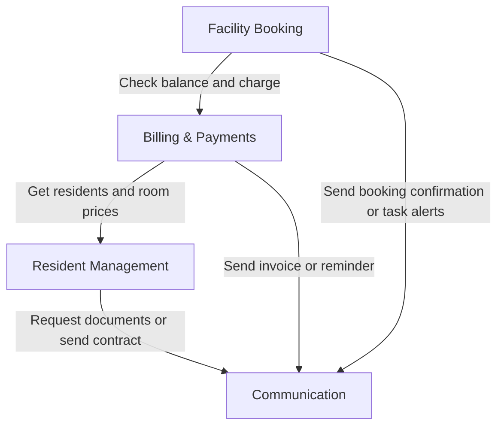
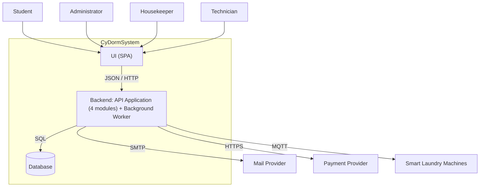

# CyDormSystem — Architecture Draft

A web application for managing student dormitories. Students book facilities, pay rent, and submit complaints or room requests. Administrators register students, configure billing, and handle complaints. Housekeepers and technicians manage cleaning and maintenance tasks.

## 1. Features (Core MVP)

| Feature | User story | User–system interaction |
|---|---|---|
| Student registration | As an admin, I want to register students so they can become residents. | Admin enters details → system checks duplicates and documents → saves application → sends contract or requests missing documents. |
| Laundry booking | As a student, I want to reserve a machine to avoid waiting. | Student selects machine/time → system checks availability and balance → charges account, unlocks machine (MQTT) and saves booking → shows confirmation. |
| Monthly invoices | As an admin, I want automatic invoices and reminders to reduce manual work. | Admin configures billing date → worker gets residents and prices → calculates rent → saves invoice → emails PDF → reminds if unpaid. |
| Complaints | As a student, I want to report a problem so administrators can handle it. | Student submits message → system validates and saves → confirms submission → notifies admin → displays complaint in inbox. |
| Study-room & gym booking | As a student, I want to reserve a study room or gym slot. | Student searches date/time/location → system lists free slots → student selects slot → system checks overlaps, saves and confirms. |
| Cleaning & maintenance | As a student, I want to request cleaning or repairs; as staff, I want to track assigned tasks. | Student submits room request → system routes to Housekeeper or Technician → staff updates task status → system updates room readiness and notifies student. |

## 2. Modules and responsibilities

Four business modules deployed across two backend runtime containers (**API Application** and **Background Worker**). **Auth & RBAC** (4 roles) and **Audit Logger** are shared across modules.

| Module | Presentation: screens | Business/Application: rules | Infrastructure: storage and integrations |
|---|---|---|---|
| Resident Management | Registration form, resident profile & status | Validate student details, check duplicates, verify documents, approve applications and supply resident/price data | Save students and applications, fetch/store documents |
| Facility Booking | Available machines/rooms/gym, cycle ETA, booking confirmation, cleaning & maintenance tasks | Filter free facilities, check overlaps, create/cancel bookings, ask Billing to charge for laundry, route cleaning/maintenance tasks and track status transitions | Load/save bookings, facilities and tasks, unlock/lock smart laundry machines (MQTT) |
| Billing & Payments | Balance, top-up, receipts, billing settings | Validate billing config, check/update balance, schedule monthly billing jobs, calculate rent, set due dates, flag overdue invoices | Store billing config, balances and invoices, run scheduled worker jobs, generate PDFs, create payment links and verify webhooks |
| Communication | Complaint form, room request form, admin inbox & unread counter | Validate/route complaints, count unseen messages, compose contracts, doc requests, confirmations, invoices, reminders and task alerts | Store complaints and delivery status, send emails with PDF attachments and handle retries (SMTP) |

Responsibilities concerning the same business area stay together. Other modules request their results rather than repeating their rules.

## 3. Module dependencies

Arrows mean "uses".

Example: laundry booking checks the slot, asks Billing to charge the student, unlocks the machine via MQTT, saves the booking and asks Communication to send confirmation.

## 4. Application structure

The UI displays role-specific views (`Student`, `Admin`, `Housekeeper`, `Technician`). The `API Application` enforces RBAC and synchronous business rules, while the `Background Worker` handles scheduled monthly invoicing, PDF generation and payment reminders. The database stores students, facilities, bookings, tasks, balances, invoices and complaints.
