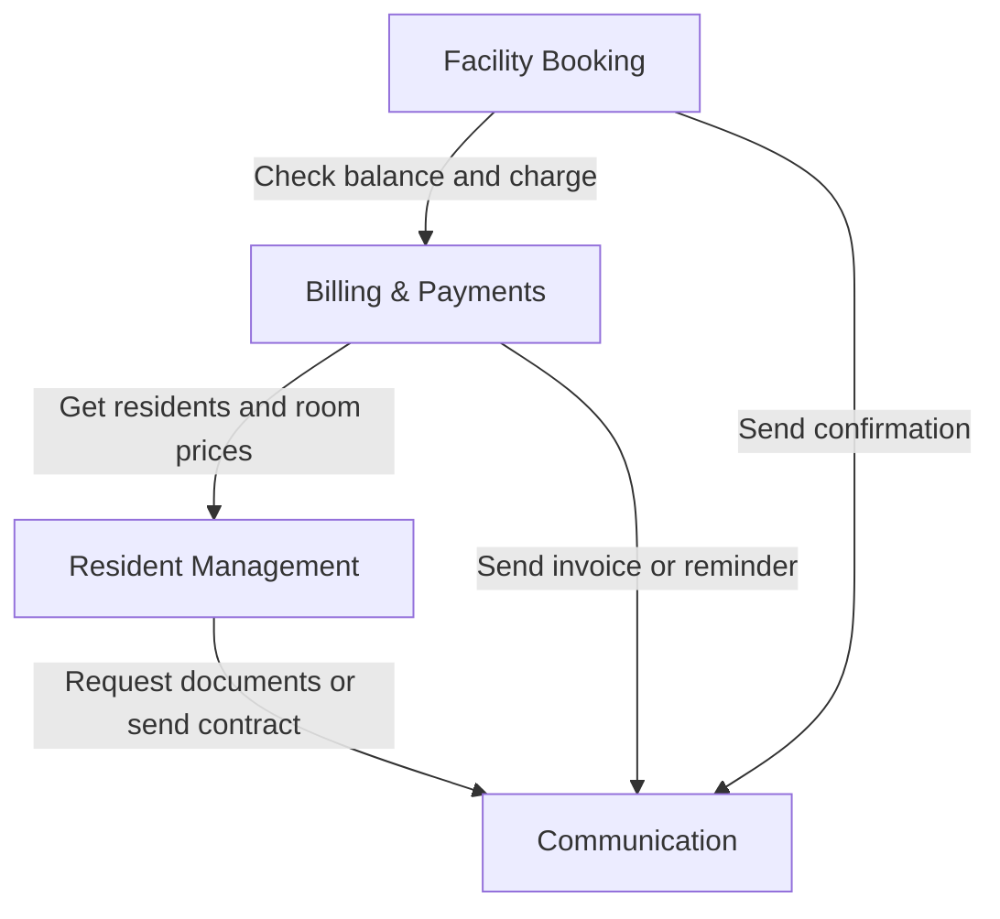
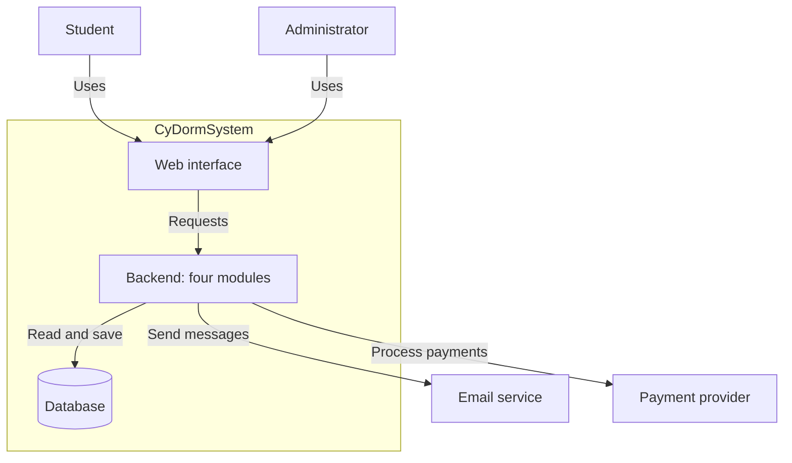

# CyDormSystem — Architecture Draft

A web application for managing student dormitories. Students book facilities, pay rent and submit complaints. Administrators register students, configure billing and handle complaints.

## 1. Features

| Feature | User story | User–system interaction |
|---|---|---|
| Student registration | As an admin, I want to register students so they can become residents. | Admin enters details → system checks duplicates and documents → saves application → sends contract or requests missing documents. |
| Laundry booking | As a student, I want to reserve a machine to avoid waiting. | Student selects machine/time → system checks availability and balance → charges account and saves booking → shows confirmation. |
| Monthly invoices | As an admin, I want automatic invoices and reminders to reduce manual work. | Admin configures billing date → system gets residents and prices → calculates rent → saves invoice → emails PDF → reminds if unpaid. |
| Complaints | As a student, I want to report a problem so administrators can handle it. | Student submits message → system validates and saves → confirms submission → notifies admin → displays complaint in inbox. |
| Study-room booking | As a student, I want to reserve a study space. | Student searches date/time/location → system lists free rooms → student selects room → system checks overlaps, saves and confirms. |

## 2. Modules and responsibilities

Four modules inside one backend. Login and role checks are shared.

| Module | Presentation: screens | Business/Application: rules | Infrastructure: storage and integrations |
|---|---|---|---|
| Resident Management | Registration form, resident details | Check student details, documents and duplicates, then approve and supply resident/price data | Save students and applications, fetch documents |
| Facility Booking | Available machines/rooms, booking confirmation | Check times and overlaps, create the booking, ask Billing to charge for laundry | Load resources, save bookings, update machine status |
| Billing & Payments | Balance, top-up, invoices, billing settings | Check/update balance, calculate rent, set due dates, flag overdue invoices | Store billing data, run scheduled billing, generate PDFs, talk to the payment provider |
| Communication | Complaint form, admin inbox | Check complaints, mark read/unread, prepare messages others ask for | Store complaints, send contracts, confirmations, invoices and reminders |

Responsibilities concerning the same business area stay together. Other modules request their results rather than repeating their rules.

## 3. Module dependencies

Arrows mean “uses”.

Example: laundry booking checks the slot, asks Billing to charge the student, saves the booking and asks Communication to send confirmation.

## 4. Application structure

The web interface displays forms and results. The backend checks permissions and business rules. The database stores students, resources, bookings, invoices and complaints.
